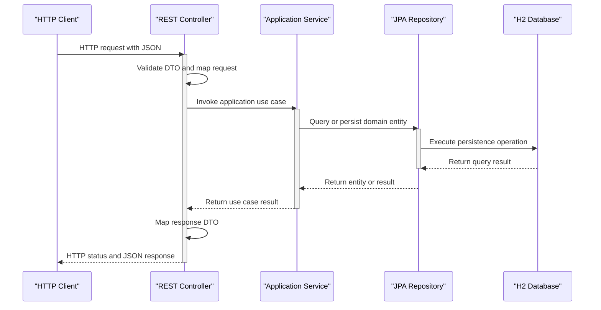

# API & Service Communication Contracts

The EstanteDigital API exposes 20 HTTP endpoints for health, authentication demonstration, books, customers, employees, and sales. Requests and responses use synchronous HTTP/JSON; internal calls are direct and synchronous.

## Service Catalog

| Service | Port | Category | Purpose |
| --- | --- | --- | --- |
| EstanteDigital API (`estantedigital`) | 8080 | API Layer | Spring Boot REST API and application use cases, deployed as one service. |

## API Endpoints Inventory

| Service | Method | Path | Request Type | Response Type |
| --- | --- | --- | --- | --- |
| EstanteDigital API | GET | `/health` | None | `Health` (200) |
| EstanteDigital API | POST | `/auth/login` | `LoginRequestDTO` body | `TokenResponseDTO` (200); `ApiExceptionDTO` (400/401) |
| EstanteDigital API | GET | `/books` | Query: `page`, `size`, `title`, `author` | `PageResponseDTO<BookResponseDTO>` (200); error (400) |
| EstanteDigital API | POST | `/books` | `BookRequestDTO` body | `BookResponseDTO` (201); error (400/409) |
| EstanteDigital API | GET | `/books/{id}` | `id` path | `BookResponseDTO` (200); empty (404) |
| EstanteDigital API | PUT | `/books/{id}` | `id` path; `BookRequestDTO` body | `BookResponseDTO` (200); error (400/409); empty (404) |
| EstanteDigital API | DELETE | `/books/{id}` | `id` path | Empty (204); empty (404) |
| EstanteDigital API | GET | `/customers` | Query: `page`, `size`, `name`, `cpf`, `status` | `PageResponseDTO<CustomerResponseDTO>` (200); error (400) |
| EstanteDigital API | POST | `/customers` | `CustomerRequestDTO` body | `CustomerResponseDTO` (201); error (400/409) |
| EstanteDigital API | GET | `/customers/{id}` | `id` path | `CustomerResponseDTO` (200); empty (404) |
| EstanteDigital API | PUT | `/customers/{id}` | `id` path; `CustomerRequestDTO` body | `CustomerResponseDTO` (200); error (400/409); empty (404) |
| EstanteDigital API | DELETE | `/customers/{id}` | `id` path | Empty (204); empty (404) |
| EstanteDigital API | GET | `/employees` | Query: `page`, `size`, `name`, `cpf`, `status`, `registrationNumber` | `PageResponseDTO<EmployeeResponseDTO>` (200); error (400) |
| EstanteDigital API | POST | `/employees` | `EmployeeRequestDTO` body | `EmployeeResponseDTO` (201); error (400/409) |
| EstanteDigital API | GET | `/employees/{id}` | `id` path | `EmployeeResponseDTO` (200); empty (404) |
| EstanteDigital API | PUT | `/employees/{id}` | `id` path; `EmployeeRequestDTO` body | `EmployeeResponseDTO` (200); error (400/409); empty (404) |
| EstanteDigital API | DELETE | `/employees/{id}` | `id` path | Empty (204); empty (404) |
| EstanteDigital API | GET | `/sales` | Query: `page`, `size`, `customerCpf`, `bookTitle`, `employeeRegistrationNumber` | `PageResponseDTO<SaleResponseDTO>` (200); error (400) |
| EstanteDigital API | POST | `/sales` | `SaleRequestDTO` body | `SaleResponseDTO` (201); error (400) |
| EstanteDigital API | GET | `/sales/{id}` | `id` path | `SaleResponseDTO` (200); empty (404) |

No API versioning scheme is configured. List endpoints default to page `0` and
size `10`, with maximum size `100`. Error responses use `ApiExceptionDTO` where
the application provides a body; missing resources on single-resource reads
and deletes return an empty `404`.

## Management & Observability Endpoints

| Service | Endpoint | Custom Metrics (if any) |
| --- | --- | --- |
| EstanteDigital API | `GET /health` (custom health response) | None identified |

No Spring Boot Actuator endpoints or custom metrics are configured.

## DTOs & Contracts

`BookRequestDTO`, `CustomerRequestDTO`, `EmployeeRequestDTO`, `SaleRequestDTO`,
and `LoginRequestDTO` are request contracts. `BookResponseDTO`,
`CustomerResponseDTO`, `EmployeeResponseDTO`, `SaleResponseDTO`,
`PageResponseDTO<T>`, `ApiExceptionDTO`, `TokenResponseDTO`, and `Health` are
response contracts. `PageResponseDTO<T>`, `LoginRequestDTO`,
`TokenResponseDTO`, and `Health` are Java records and immutable; the other DTOs
are mutable POJOs.

There is no gateway-level DTO or cross-service aggregation: `SaleResponseDTO`
composes response DTOs belonging to the same application. Domain entities are
internal service models and are mapped explicitly rather than returned by
controllers. Jackson is used by Spring's HTTP message conversion. The
repository includes a static OpenAPI specification at
[`docs/openapi.yaml`](../../../../../docs/openapi.yaml) and generates interactive
Swagger UI documentation at `/swagger-ui/index.html`, with JSON at
`/v3/api-docs`; no GraphQL or protobuf contracts were found.

## Communication Patterns

- **Synchronous:** external consumers call the API with HTTP/JSON. Controllers
  invoke services directly, which use Spring Data JPA repositories.
- **Asynchronous:** no message broker, event bus, or asynchronous service
  communication was identified.
- **Resilience:** no retry, circuit-breaker, bulkhead, or explicit downstream
  timeout policy was identified.
- **Discovery and gateway:** no service discovery, API gateway, or client-side
  load balancing is configured.
- **Startup dependencies:** the application uses embedded H2; no external
  service startup dependency was identified.
- **Security posture:** Spring Security supports a demonstration JWT login,
  but current authorization rules permit all endpoints. JWT is not required
  for API access, no role-based endpoint restriction is applied, and the
  application does not configure TLS.

## Service Technology Matrix

| Service | Web | Data Access | Discovery | Gateway | Actuator | Cache | Metrics |
| --- | --- | --- | --- | --- | --- | --- | --- |
| EstanteDigital API | Spring MVC | Spring Data JPA | None | None | No (custom `/health` only) | None identified | None identified |

## Service Communication Sequence

<!-- mermaid-checked: every participant uses `participant Id as "Label"`, no \n in aliases/messages/notes, every alt/opt/loop closed by end, no `:` inside any alias -->

